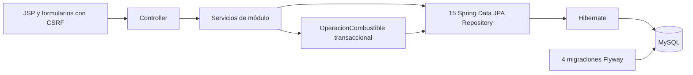

# Persistencia real y revisión previa a publicación

Fecha: 30 de octubre de 2026, America/Lima.

## Resultado y condición de publicación

**El usuario autorizó expresamente la publicación en main con la prueba de reinicio pendiente. El cierre completo no está aprobado.** La integración JPA/MySQL está
implementada y `mvnw.cmd verify -q` terminó con 48 pruebas aprobadas, cero fallos, cero errores y cero omisiones. Sin embargo, **no se completó la prueba obligatoria
de reinicio del WAR**: el archivo desapareció durante el arranque/consulta inicial
y el proceso Java terminó con código 0, sin una excepción de aplicación registrada.
Windows denegó después la escritura del mismo nombre de archivo. No se confirmó
la causa a través de los registros accesibles ni se alteraron protecciones del equipo.
El usuario informó de una alerta que había retirado; el reintento posterior de
`mvnw.cmd package -DskipTests -q` volvió a fallar al escribir el WAR. Por tanto,
el último empaquetado no se presenta como aprobado aunque el verify anterior sí pasó.

En la revisión anterior a la autorización no se hicieron commit, push ni cambios en la rama remota. No se
preparó el índice Git como si todas las condiciones de aceptación hubieran pasado.
`git fetch origin` se ejecutó y la comparación dio 0 commits locales exclusivos
y 0 remotos exclusivos frente a `origin/main`.

## Auditoría de partida

Se leyeron el README, el informe 26 y los cambios existentes. El estado real
incluía más archivos que los recuentos abreviados de las solicitudes: 22 archivos
Java/README modificados en la primera revisión, además de JSP y clases nuevas.
El inventario final usa los nombres obtenidos de Git, sin fijar artificialmente
un total de 22 o 33 archivos.

Los nueve ServiceImpl originales guardaban sus datos en listas. No había
Repository ni conexión desde Java. Las 20 comprobaciones MySQL anteriores
probaban un DDL aislado y su reinicio; no eran pruebas de compras o ventas Java.
La documentación histórica y sus evidencias se conservaron. Se realizó una copia
local previa de fuentes en `target/`, excluida de Git.

## Arquitectura implementada

Las clases de modelo existentes se mapearon como entidades, conservando sus nombres.
Se agregaron únicamente las tres entidades del diccionario que faltaban:
Proveedor, Rol y CajaDiaria. No se agregó Cliente ni un catálogo de actores externos
con acceso al login.

Las quince parejas Entity/Repository son:

- Categoria / CategoriaRepository.
- Producto / ProductoRepository.
- Proveedor / ProveedorRepository.
- Compra / CompraRepository y DetalleCompra / DetalleCompraRepository.
- Venta / VentaRepository y DetalleVenta / DetalleVentaRepository.
- MovimientoInventario / MovimientoInventarioRepository.
- ConceptoMovimiento / ConceptoMovimientoRepository.
- CajaDiaria / CajaDiariaRepository.
- MovimientoCaja / MovimientoCajaRepository.
- Empleado / EmpleadoRepository.
- Rol / RolRepository.
- Usuario / UsuarioRepository.
- Asistencia / AsistenciaRepository.

Se conservan las 15 tablas, 109 columnas de negocio y 22 relaciones FK del modelo.
La tabla técnica de historial de Flyway no se cuenta como entidad del negocio.
Los IDs internos son Long/BIGINT. Para mantener las JSP y URLs existentes, los
modelos con códigos comerciales conservan `getId()` como código y exponen la PK
interna mediante `getClave()`. Las FK de formulario compatibles son `@Transient`;
las relaciones persistidas son referencias JPA con claves numéricas reales.

Se utilizan ManyToOne y OneToOne, FK restrictivas, índices, unicidad de cuentas,
códigos, DNI, RUC, categorías, productos por categoría, jornadas y orígenes de
movimientos. Hibernate valida el esquema; no lo borra ni lo recrea automáticamente.
No hay perfil H2 ni respaldo mediante listas cuando MySQL falla.

## Servicios y transacciones

Se migraron CategoriaServiceImpl, ProductoServiceImpl, EmpleadoServiceImpl,
UsuarioServiceImpl, CompraServiceImpl, VentaServiceImpl,
MovimientoInventarioServiceImpl, MovimientoCajaServiceImpl y AsistenciaServiceImpl.
Las listas que quedan son resultados de consultas, DTO de formularios o datos de
presentación; no son almacenamiento del sistema.

ProveedorService mantiene el catálogo persistido. CajaDiariaService abre y cierra
una caja por fecha. DashboardService calcula indicadores desde repositorios.
ActorActual revalida al usuario, empleado y rol persistidos. Los permisos de
escritura también se aplican en servicios mediante seguridad de métodos.

OperacionCombustible coordina la compra o venta completa con `@Transactional`:

1. Comprueba la solicitud única, caja abierta, responsable y datos maestros.
2. Bloquea la caja diaria y después los productos ordenados por código.
3. Valida todas las líneas, cantidades acumuladas por producto e importes.
4. Guarda cabecera y detalles, actualiza stock y registra un movimiento físico por línea.
5. Guarda un único movimiento económico relacionado con la operación y su caja.

Los `flush` no confirman pasos parciales. La confirmación corresponde a la
transacción exterior. Las pruebas indujeron una violación CHECK al guardar el
movimiento económico y verificaron desde nuevas consultas MySQL que no quedaban
cabeceras, detalles, movimientos ni variaciones de stock de la operación fallida.

La caja se bloquea también al cerrar para impedir una operación simultánea sobre
una caja ya cerrada. El saldo se obtiene de apertura más ingresos menos egresos.
Se retiró la apertura constante de la implementación anterior.

Los códigos únicos persistidos de compra y venta se derivan del token emitido por
el servidor. Repetir el código no duplica efectos, aunque se vuelva a invocar el
servicio. Los códigos nuevos respetan las longitudes del diccionario y no dependen
de calcular `MAX + 1` sobre una lista; los códigos anteriores C001/V001/PR01 se
conservan en los datos de demostración y rutas. Las claves únicas SQL siguen siendo
la última barrera frente a carreras. Los ajustes manuales mantienen la protección
de formulario por sesión; no se atribuye a esa protección una garantía distribuida.

## Fechas, seguridad e interfaces

- DATE, TIME y DATETIME se corresponden con LocalDate, LocalTime y LocalDateTime.
  Dinero usa DECIMAL(12,2); litros, DECIMAL(12,3).
- Las operaciones usan Clock de servidor y America/Lima. La precisión de segundos
  coincide con TIME/DATETIME del diccionario. El navegador no decide responsable,
  fecha de operación, precio de venta ni total.
- Se conservan BCrypt, CSRF, sesiones y logout. Se verifica estado de cuenta,
  empleado y rol, incluso para sesiones anteriores a una desactivación.
- Se agregó el CRUD de proveedores P31/P32, filtros por RUC, nombre y estado y
  selector de proveedor activo en compras.
- Compras y ventas permiten varias líneas; la interfaz agrega combustibles y el
  backend valida la operación completa antes de modificar existencias.
- Compras filtra por proveedor, responsable identificado con su empleado, fechas,
  estado y combustible. Personal y cuentas disponen de filtros sobre datos persistidos.
- Finanzas incorpora apertura, cierre e historial de caja. No hay alta manual de
  movimientos económicos que deban generarse por compras o ventas.
- El dashboard presenta los cinco KPI y cinco series del informe para Administrador.
  Vendedor ve información de ventas y existencias; Operador ve existencias. Las
  series muestran fórmula, unidad, periodo, objetivo y fuente de información.
- El resumen de inventario ya no utiliza una base fija de 6 700 litros: identifica
  la base física derivada de existencias actuales y movimientos registrados.

## RN01–RN05

- RN01: validaciones y CHECK de stock no negativo, validación acumulada de líneas,
  bloqueo relacional y prueba con dos ventas concurrentes.
- RN02: bajas lógicas y FK sin borrado destructivo; los registros inactivos y sus
  categorías no se ofrecen para operaciones nuevas. La cuenta de empleado inactivo
  no tiene acceso aunque el estado propio de la cuenta siga siendo Activo.
- RN03: detalles y movimientos físicos en la transacción de compra/venta; unicidad
  por origen y prueba de reenvío/código repetido. Rollback completo probado en MySQL.
- RN04: movimientos económicos persistidos, origen único, caja abierta y saldo
  calculado. Apertura y cierre guardan responsables y marcas temporales.
- RN05: empleado propio y activo, fecha/hora del servidor y unicidad por fecha.
  La prueba de 24 entradas concurrentes detectó una lectura antigua bajo la
  instantánea de MySQL; se corrigió con lectura bloqueante posterior al bloqueo
  del empleado y la prueba pasó sin duplicados ni excepciones para los reintentos.

## Migraciones incluidas

Las cuatro migraciones activas están en `src/main/resources/db/migration/`:

1. V1__modelo_objetivo.sql: tablas, tipos, PK, FK, restricciones y unicidad de origen.
2. V2__catalogos_iniciales.sql: Administrador, Operador, Vendedor y los dos conceptos automáticos.
3. V3__indices_operativos.sql: índices de operaciones, inventario, caja y asistencia.
4. V4__unicidad_conceptos.sql: respaldo relacional de la unicidad ya validada por el servicio.

Los datos ficticios se cargan solo con el perfil demo, una vez y sin reemplazar
registros existentes. La contraseña se obtiene de NEXO_DEMO_PASSWORD; ya no hay
una contraseña pública literal en el código. Fuera de demo, el primer administrador
requiere los valores NEXO_ADMIN_* y no se restablece en reinicios posteriores.

El SQL de `documentacion/persistencia/` se conserva como antecedente de la primera
fase; las migraciones ejecutadas por Spring Boot están en resources.

## Pruebas ejecutadas

`mvnw.cmd verify -q` finalizó con código 0 y 48 pruebas: 16 de reglas, 4 de
formularios únicos, 16 de seguridad/HTTP con MockMvc, 9 de persistencia y 3 de
HTTP real con Tomcat/Jasper. No hubo fallos, errores ni casos omitidos.
El empaquetado generó `target/estacion-nexo.war` antes del intento de arranque.
El nombre estable del WAR está configurado en pom.xml y documentado en README.

La evidencia de Maven está en
[resultados_persistencia_20261030.json](evidencias/resultados_persistencia_20261030.json).
Los reportes Surefire completos son archivos locales dentro de target y no se publican.
La revisión de secretos sobre archivos publicables está en
[resultados_secretos_publicacion.json](evidencias/resultados_secretos_publicacion.json).

Las excepciones SQL CHECK de las pruebas de rollback son fallos inducidos y
esperados. No se desactivaron validaciones, CSRF ni autorización. El primer intento
de inyectar el fallo con trigger necesitaba privilegios adicionales y se sustituyó
por una CHECK temporal exclusiva de `nexo_pruebas`, retirada al terminar la prueba.
No se ampliaron privilegios del servidor para lograr PASS.

Se observaron avisos de instrumentación de Mockito con Java 21 y de la versión de
MySQL frente al rango declarado por Flyway gestionado por Boot. Las cuatro
migraciones se aplicaron y validaron en MySQL 8.4.13; los avisos no se ocultaron.

## Reinicio del WAR: resultado no completado

El verificador inicia el WAR, registra operaciones por formularios con login y
CSRF, compara stock/caja y detiene e inicia Java con la misma base. Está preparado
para comprobar también proveedores, usuarios y asistencia sin copiar hashes ni
tokens a la evidencia. **Esa secuencia no llegó a completarse en este equipo.**

El WAR llegó a iniciar Tomcat y MySQL, pero desapareció del disco durante la
consulta inicial y el proceso terminó con código 0. Por tanto, no se consideran
aprobadas las altas por formularios del WAR ni la comparación antes/después.
Los éxitos de MockMvc, de Tomcat/Jasper de pruebas y de consultas SQL no sustituyen
esa comprobación pendiente.

El resultado observado está en
[resultados_reinicio_aplicacion_bloqueado.json](evidencias/resultados_reinicio_aplicacion_bloqueado.json).
No se confirmó la causa. No se modificaron antivirus, exclusiones ni protecciones.
Los logs locales de diagnóstico permanecen en target, fuera de la propuesta de publicación.

## Revisión Git y archivos publicables

El manifiesto exacto está en
[28_archivos_propuestos_publicacion.md](28_archivos_propuestos_publicacion.md).
Incluye fuentes, vistas, migraciones, pruebas, configuración sin valores secretos
y documentación/evidencias. Se conserva el material académico anterior; solo se
redactó el valor literal de demostración donde aparecía.

`target/migrar_modelos.py` y `target/migrar_catalogos.py` fueron auxiliares de
transformación, no componentes de ejecución ni del build. Están ignorados y no
hay archivos de target seguidos por Git. Tampoco se publican la copia previa,
los WAR, las clases, los logs ni la configuración privada local de las pruebas.

El escaneo no encontró valores conocidos del entorno ni patrones de claves
privadas, tokens GitHub/API/AWS o sesiones literales. Los HTML históricos conservan
marcadores CSRF redactados, no tokens activos. Las variables de entorno y las
plantillas JSP no contienen credenciales literales.

`git diff --check` pasó. `git fetch origin` y la comparación HEAD...origin/main
dieron 0/0 en la revisión previa. La autorización posterior permite commit y push normal a main, conservando el límite del WAR.

Título autorizado para la publicación:
`feat: completar integracion MySQL y persistencia de Estacion Nexo`.

## Pendientes y límites respecto del informe

- Resolver el bloqueo local del WAR y ejecutar el verificador completo antes de
  dar por aprobada la persistencia después del reinicio de la aplicación. La publicación fue autorizada expresamente con esta limitación.
- El proyecto académico completo sigue teniendo pendientes ajenos a esta integración:
  contenido real de portada/contacto, evidencias docentes y decisiones del Anexo H.
- La política para jornadas antiguas abiertas y generación de faltas no se inventó.
  El diccionario exige hora_entrada NOT NULL, mientras un ejemplo histórico de falta
  carecía de marcación; la semilla no inserta una fila incompatible con esa restricción.
- La prueba de aprovisionamiento inicial sin perfil demo no se presenta como ejecutada.
  Las pruebas verificadas usaron una base aislada y datos ficticios explícitos.
- No se certifica el total de 49 funcionalidades como terminado ni se extrapolan
  los antiguos 133/133 o los 20 chequeos SQL aislados a la nueva aplicación.

Las instrucciones actuales están en el [README](../README.md). Para detener
MySQL sin borrar sus registros puede utilizarse `docker compose stop`; no es
necesario eliminar volúmenes para reiniciar la aplicación.
